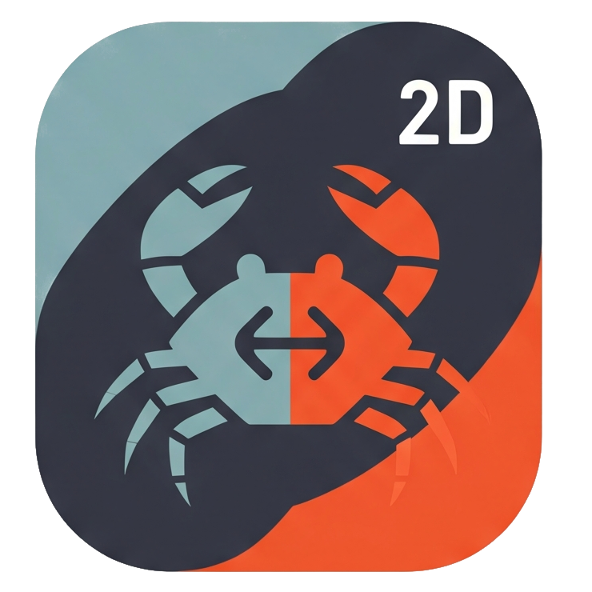
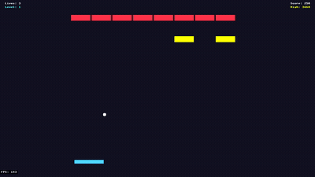
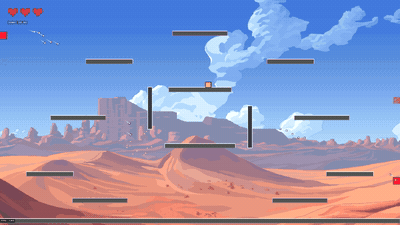

<p align="center">
  
</p>

# Ryo2D

*Tagline:*
A Rust 2D game engine designed with agent-assisted development in mind from the beginning. Build professional games with AI agents or by hand with a sane API and traditional code -- your choice.

*Reality:*
I started learning Rust and then I decided to start building a 2D game engine to apply the language; all while using agentic tools.

**Should you use this engine today?** Probably not -- it's constantly evolving and is one big experiment. Use at your own risk.

## Example Games

<p align="center">
  
  
</p>
<p align="center">
  
</p>

## Quick Start

### Install

```powershell
# Windows
git clone https://github.com/Kersheh/ryo2d.git
cd ryo2d
./install # Windows
./install.sh # macOS / Linux
```

### Create a Game

```bash
ryo2d init my-game
cd my-game
ryo2d dev
```

When you run `ryo2d init`, you'll be prompted to install **Agent Skills**—domain-specific knowledge that helps AI assistants understand the engine's APIs and patterns. This is **highly recommended** for agentic game development.

## CLI Commands

| Command | Description |
|---------|-------------|
| `ryo2d init <name>` | Create a new game project |
| `ryo2d build` | Build production release |
| `ryo2d run` | Run the production build |
| `ryo2d dev` | Development mode with hot-reload |
| `ryo2d export` | Package release into distributable zip |
| `ryo2d install-skills` | Add Agent Skills to existing project |
| `ryo2d netplay` | Test multiplayer with friends over internet |

## Dev Build Performance

New projects include optimized dependencies for playable dev builds. If you're upgrading an existing project or experiencing slow dev builds, add this to your `Cargo.toml`:

```toml
[profile.dev.package."*"]
opt-level = 2
```

This optimizes dependencies (physics, rendering) while keeping your game code fast to compile. `ryo2d dev` will warn you if this is missing.

## Core Features

### Architecture
- **ECS** — Entity-Component-System with generational IDs and archetype storage
- **Scene Management** — Stack-based scenes with transitions
- **Event Bus** — Decoupled publish-subscribe communication
- **Object Pooling** — Pre-allocated entity pools for bullets, particles, effects
- **State Machines** — Generic FSM and state stack for player states, AI, menus

### Rendering
- **Sprites** — GPU-batched rendering with z-ordering and per-sprite shaders
- **Animation** — Sprite sheets, state machine controllers, 24 easing functions
- **Tweening** — Smooth interpolation of position, rotation, scale
- **Parallax** — Layered scrolling backgrounds with infinite scroll
- **2D Lighting** — Point lights, spotlights, volumetric effects, atmospheric scattering
- **Shadow System** — Hard shadows, soft shadows, ray-marched shadows, drop/blob/contact shadows, ambient occlusion
- **Trails** — Motion path rendering with fade and taper effects
- **Particles** — GPU-batched particle system with emitters, attractors, and presets
- **Post-Processing** — Shader pipeline (CRT, vignette, chromatic aberration, etc.)

### Physics & Collision
- **Rapier2D** — Full physics simulation with rigid bodies
- **Collision Shapes** — AABB and circle colliders with trigger support
- **Collision Events** — Started/stopped events for gameplay logic

### Camera
- **2D Camera** — Follow targets, zoom, rotation, bounds
- **Screen Shake** — Trauma-based shake with smooth noise

### Input
- **Keyboard & Mouse** — Key states, mouse position, scroll
- **Gamepad** — Controller support via gilrs (buttons, sticks, triggers)

### Game Feel
- **Time Scale** — Slow-motion and fast-forward effects
- **Hitstop** — Freeze frames for impact feedback

### Audio
- **Kira Backend** — Music and sound effects with volume control

### UI
- **Hybrid System** — Immediate mode for HUDs, retained mode for forms
- **Widgets** — Buttons, text input, dropdowns, sliders, checkboxes, scroll views
- **Layout** — HBox, VBox, Stack containers with alignment
- **Theming** — Centralized styles with hot-reload support

### Gameplay Systems
- **Pathfinding** — A* with nav agents and grid-based navigation
- **Procedural Generation** — BSP dungeons, cellular automata, WFC, noise

### Networking
- **Client-Server** — Dedicated and listen server modes
- **Transport Layer** — UDP (LAN) or WebRTC (internet with NAT traversal)
- **Replication** — Automatic entity/component synchronization
- **RPCs** — Remote procedure calls with targeting
- **Netplay Testing** — `ryo2d netplay` for quick multiplayer testing

### Persistence
- **Save System** — 3-tier saves (system, world, game) with compression
- **Configuration** — TOML-based project settings, JSON user preferences

### Development Tools
- **Hot Reload** — Asset changes apply without restart
- **Debug Visualization** — Colliders, velocities, origins, FPS overlay
- **Profiler Window** — Real-time flamegraph with CPU/GPU timing (requires `--features profiler`)
- **Logger Window** — Live log viewer with level/context filtering

## Key Dependencies

| Crate | Purpose |
|-------|---------|
| [hecs](https://crates.io/crates/hecs) | Entity-Component-System |
| [rapier2d](https://crates.io/crates/rapier2d) | 2D Physics |
| [wgpu](https://crates.io/crates/wgpu) | GPU Rendering |
| [winit](https://crates.io/crates/winit) | Windowing |
| [kira](https://crates.io/crates/kira) | Audio |
| [image](https://crates.io/crates/image) | Image loading |
| [puffin](https://crates.io/crates/puffin) | Profiler instrumentation |

## Documentation

Build and view the documentation locally:

```bash
# Build HTML docs (mdbook guide + rustdoc API)
./build-docs.ps1   # Windows
./build-docs.sh    # macOS / Linux

# Open in browser
start docs/book/index.html        # Windows
open docs/book/index.html         # macOS
xdg-open docs/book/index.html     # Linux
```

**Note:** These docs have been auto-generated by agents throughout the process without indepth review but architecture has changed and shifted wildly throughout while possibly missing out on updating it; it may be inaccurate or confusing.

## License

MIT
