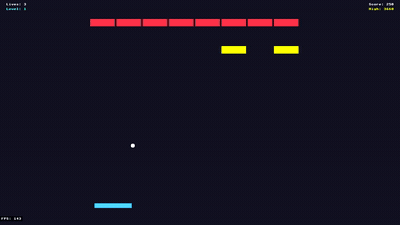

# Breakout



A classic brick-breaking game demonstrating physics and audio.

## Features Demonstrated

- **Rapier2D Physics** - Rigid body simulation with kinematic and dynamic bodies
- **Collision Events** - Game logic triggered by physics interactions
- **Tilemaps** - Ten Tiled levels loaded through the asset registry; their `brick` tiles spawn as entities and become the game's blocks (`assets/levels/`, edit them in Tiled with `assets/project.tiled-project`)
- **Audio System** - Background music, sound effects, volume controls
- **Scene Management** - Menu, Gameplay, Pause, and Quit Confirmation scenes
- **Save System** - High score persistence
- **Immediate-Mode UI** - Menus, HUD, and volume sliders

## Controls

- `A` / `D` or `←` / `→` - Move paddle
- `Space` - Launch ball
- `Escape` - Pause

## Run

```bash
ryo2d dev          # Development mode
ryo2d build && ryo2d run  # Production build
```
