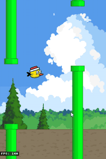

# Flappy



A Flappy Bird clone showcasing scrolling and procedural generation.

## Features Demonstrated

- **Parallax Scrolling** - Multi-layered backgrounds with varying scroll speeds
- **Procedural Generation** - Infinite pipe obstacles with randomized heights
- **Custom Physics** - Gravity and impulse-based jump mechanics
- **Scene Management** - Menu → Gameplay → Game Over flow
- **Save System** - High score persistence
- **Immediate-Mode UI** - Score display and menu screens

## Controls

- `Space` / `Click` - Flap / Start game
- `Enter` - Start game from menu
- `Escape` - Return to menu (from game over)

## Run

```bash
ryo2d dev          # Development mode
ryo2d build && ryo2d run  # Production build
```

## Debug Mode

Enable debug mode in `Ryo.toml` to test collision boundaries:

```toml
[env]
debug_scene = true
```

This adds a DEBUG button to the menu and enables the `D` key shortcut. The debug scene lets you move the bird with WASD/arrows to test collision detection.
